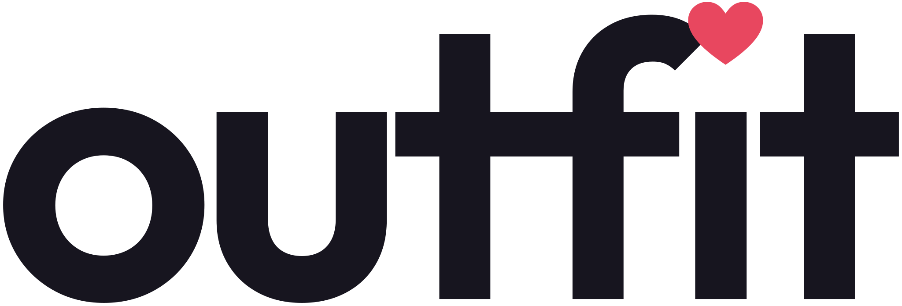
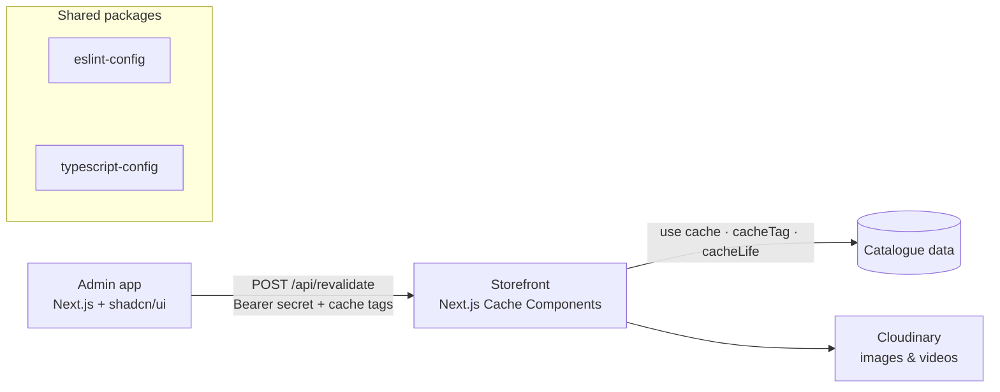

<div align="center">

<picture>
  <source media="(prefers-color-scheme: dark)" srcset="docs/assets/outfit-wordmark-white.svg" />
  <source media="(prefers-color-scheme: light)" srcset="apps/client/public/outfit-wordmark.svg" />
  
</picture>

# Outfit: Fashion E-commerce Platform

**A modern fashion storefront and admin dashboard, built as a Turborepo monorepo with Next.js 16 and React 19.**


</div>

---

## 📌 Overview

**Outfit** is a fashion e-commerce platform I'm building end to end. It has a customer-facing storefront and an internal admin dashboard, and both live in one **pnpm + Turborepo monorepo** so they can share TypeScript configs and lint rules, and builds are cached by Turborepo.

The storefront uses **Next.js 16 Cache Components** (`"use cache"`, `cacheLife`, `cacheTag`). Pages stay fast and static, and the admin app can refresh specific content on demand through a secured revalidation endpoint.

> 🚧 **Work in progress.** The storefront UI, catalogue browsing, and search are built. Checkout, auth, and a real backend are next (see [Roadmap](#️-roadmap)).

---

## ✨ Features

### 🛍️ Storefront (`apps/client`)
- **Home page** with a responsive **video hero** (separate desktop and mobile sources with poster images), a category selector, and **New arrivals**, **Bestsellers**, and **On sale** product rails
- **Sale banner** with a live countdown and a copy-to-clipboard promo code
- **Category → group → product** browsing (`/categories/[category]/[group]`) for Women, Men, Kids, Home, and Beauty
- **Filtering**: price range slider, sizes, active-filter chips, and a filter rail on desktop that becomes a filter sheet on mobile
- **Product detail page** with an image gallery, colour variants, size selection, and **add to bag / wishlist** (Zustand store)
- **Search panel** with a keyboard shortcut, suggestions, category matches, highlighted results, **recent searches**, and cancellable requests (`AbortController`)
- **Skeleton loading** states for every route and rail
- Accessible components built on **React Aria** (Untitled UI), with screen-reader announcements for bag and wishlist changes
- Light and dark themes, an announcement bar, back-to-top, and breadcrumbs

### 📊 Admin dashboard (`apps/admin`)
- Sidebar layout with breadcrumbs, a theme toggle, and an avatar menu
- **Analytics charts** (area, bar, line) built with Recharts
- **Payments table** using TanStack Table: sorting, filtering, pagination, and row selection
- **Users** list and user detail pages (`/users/[username]`)
- Forms with **React Hook Form + Zod**, and UI from **shadcn/ui**

### ⚙️ Platform
- **On-demand cache revalidation:** the admin calls `POST /api/revalidate` with a bearer secret and a list of cache tags (`products`, `categories`, `sale-banner`, `hero-videos`). The secret is checked with a **constant-time comparison** (`timingSafeEqual`).
- Product media served from **Cloudinary** with automatic format and quality (`f_auto,q_auto`)
- A workspace guard script that stops stray `pnpm-lock.yaml` / `pnpm-workspace.yaml` files inside apps, which would otherwise install duplicate dependencies and break type checks

---

## 🏗️ Monorepo Structure

```
outfit-ecom/
├── apps/
│   ├── client/        # Customer storefront: Next.js 16, React Aria (Untitled UI), Zustand, Embla Carousel
│   ├── admin/         # Admin dashboard: Next.js 16, shadcn/ui, TanStack Table, Recharts, RHF + Zod
│   └── web, docs/     # Turborepo starter apps (placeholders)
├── packages/
│   ├── ui/                  # Shared React component package (starter)
│   ├── eslint-config/       # Shared ESLint configs
│   └── typescript-config/   # Shared tsconfig presets
├── scripts/check-single-workspace.mjs
├── docs/Notes.md      # Architecture notes
└── turbo.json         # Task pipeline (build, dev, lint, check-types) with caching
```



---

## 🛠️ Tech Stack

| Area | Technologies |
|---|---|
| **Framework** | Next.js 16 (App Router, Cache Components), React 19, TypeScript |
| **Storefront UI** | Tailwind CSS, Untitled UI + React Aria Components, Embla Carousel, next-themes |
| **Admin UI** | shadcn/ui (Base UI), TanStack Table, Recharts, React Hook Form, Zod, Lucide |
| **State** | Zustand (bag, wishlist, announcements) |
| **Media** | Cloudinary |
| **Tooling** | Turborepo, pnpm workspaces, ESLint, Prettier |

---

## 🚀 Getting Started

**Requirements:** Node.js 24+ and pnpm 11

```bash
git clone https://github.com/shikharskj/outfit-ecom.git
cd outfit-ecom
pnpm install

pnpm dev                          # run all apps
pnpm dev --filter client          # storefront only
pnpm dev --filter admin           # admin only

pnpm build                        # build everything (cached by Turborepo)
pnpm lint && pnpm check-types
```

Set `REVALIDATE_SECRET` in `apps/client/.env.local` to enable the revalidation endpoint.

---

## 🗺️ Roadmap

- [x] Monorepo setup with shared configs
- [x] Storefront: home, categories, filters, product page, search
- [x] Admin: layout, charts, payments table, users
- [ ] Backend API and database for products, orders, and users
- [ ] Authentication (customers + admin roles)
- [ ] Cart → checkout → payments
- [ ] Admin CRUD for products, banners, and hero videos (wired to revalidation)
- [ ] Deployment

---

## 👨‍💻 Author

**Shikhar Jaiswal** · [GitHub](https://github.com/shikharskj) · [LinkedIn](https://www.linkedin.com/in/shikharskj/)
